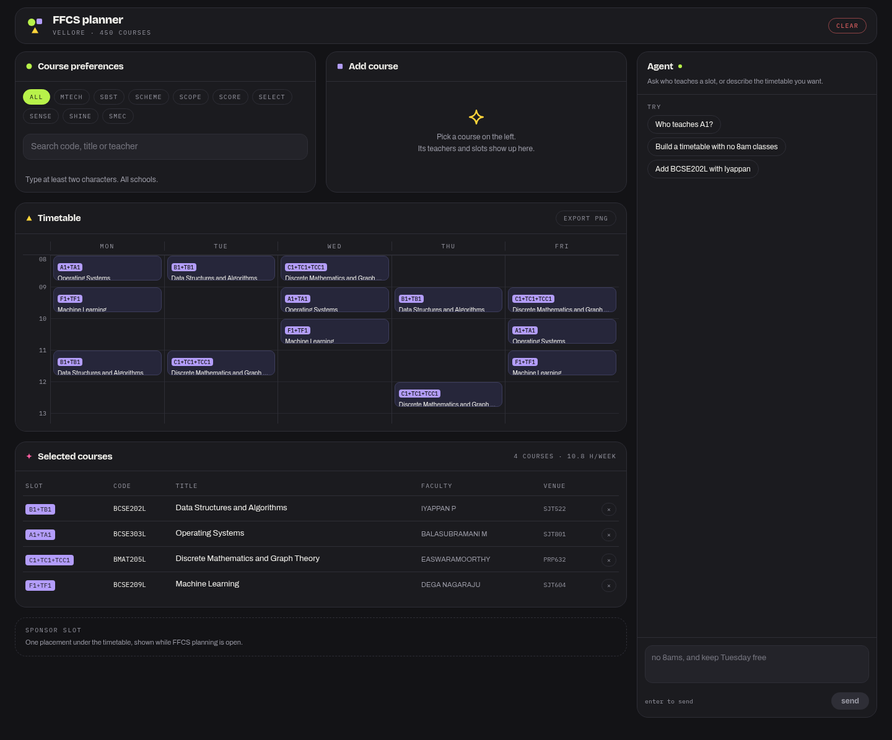

# FFCS planner

Build a VIT FFCS timetable by talking to it. Ask which faculty teach a slot, add courses, and let a
deterministic solver place them. The model never invents a slot or a clash-free grid.



## Why this one

FFCS on the Go and FFCS-inator both make you rebuild the whole timetable when one preference
changes, and neither can answer "who teaches A1 on Tuesday" — the question that decides half of
FFCS. Here the timetable is a state you edit in plain English, and every edit is checked by a solver
that compares real clock intervals:

- Theory hours are 50 minutes, labs are 2-hour blocks. A lab ending 9:40 clashes with a 9:00 theory
  hour, and the engine catches it.
- Embedded courses (`BCSE101E`) publish theory and lab as two offerings under one code. Adding one
  reserves both blocks.
- Courses with no scheduled hours (projects, Indian Constitution) never clash.

## Quick start

```bash
npm install
cp .env.example .env      # add OPENCODE_API_KEY
npm run dev               # http://localhost:3000
```

Without a key the planner still works: search, add, solve, export. Only the chat panel is disabled.

## Configuration

| Variable | Default | Notes |
|---|---|---|
| `OPENCODE_API_KEY` | — | Service-account key. Server-side only. |
| `OPENCODE_BASE_URL` | `https://opencode.ai/zen/go/v1` | Go subscription. Needs the session header, which `config.ts` sends. |
| `OPENCODE_MODEL` | `deepseek-v4.1-flash` | `muse-spark-1.3-contributor` also answers on Go. |
| `NEXT_PUBLIC_ADSENSE_CLIENT` | unset | Unset renders a house ad for the slot. |
| `NEXT_PUBLIC_ADSENSE_SLOT` | unset | Ad unit id. |
| `NEXT_PUBLIC_SPONSOR_CONTACT` | unset | Adds a mailto to the house ad. |

The other gateway, `https://opencode.ai/inference/openai/v1`, bills a credit balance instead of the
subscription and does not need the session header. Model ids must be bare (`deepseek-v4.1-flash`),
not provider-prefixed. Verify any change with `npm run agent:check`.

## Scripts

| Command | What it does |
|---|---|
| `npm run dev` | Dev server |
| `npm run build` | Production build |
| `npm test` | 38 tests over grid, conflicts, solver, tools and the chat route |
| `npm run typecheck` | `tsc --noEmit` |
| `npm run agent:check` | Verifies key, model id and tool calling against the inference API |
| `npm run catalog:import` | Rebuilds `data/catalog.vellore.json` from `vendor/ffcs-data` |
| `npm run solve -- timetable.json` | Solves a timetable from JSON, no server or key needed |

## How it works

```
chat → tool calls → state ops → solver → ranked arrangements → agent explains
```

The agent **never generates a timetable**. It calls `search_courses`, `who_teaches`,
`add_course`, `set_constraints` and friends; those return state ops that the browser applies
verbatim, so a manual edit and an agent edit are the same mutation.

- `src/lib/ffcs/grid.ts` — slots as minute intervals; theory and lab periods are not aligned.
- `src/lib/ffcs/conflicts.ts` — overlap detection and hard constraints.
- `src/lib/ffcs/solver.ts` — branches on distinct slot patterns, not on faculty variants, then
  ranks by preferred faculty, gaps, days used and early/late hours.
- `src/lib/agent/tools.ts` — the model's only way to touch the timetable.

## The skill

`skill/ffcs-planner/` is a standalone skill for OpenCode/Claude-style agents. It documents the
catalog, the request format and the slot gotchas, and points at the CLI:

```bash
cp -r skill/ffcs-planner ~/.config/opencode/skill/ffcs-planner
```

Copy that folder next to a checkout, or run it inside this repo. No server, no API key.

## Data

The catalog is vendored from [CodeChefVIT/ffcs](https://github.com/CodeChefVIT/ffcs) at
`b2bafad` (MIT, see `vendor/ffcs-data/LICENSE`) and normalised by `npm run catalog:import`:

| | |
|---|---|
| Courses | 450 |
| Faculty offerings | 3,066 |
| Faculty | 902 |
| Unknown slot codes | 0 |
| Courses with no scheduled hours | 11 |
| Credits | `null` — the source has none |

Vellore only, one semester. The source does not state the term, so the UI never guesses one.

## Limits

- Credits are unknown, so no credit total and no `maxCredits` yet.
- Anonymous only: the timetable lives in `localStorage`, share is a PNG.
- Rate limiting is per process. Move it to a shared store before more than one instance.
- The agent is verified against `deepseek-v4.1-flash` on the OpenCode Go gateway: it calls
  `who_teaches` and `add_course` with real catalog data and asks instead of guessing when two
  faculty match. The tool loop is also covered by a fake OpenAI-compatible server in tests.

## Docs

- `docs/DECISIONS.md` — every assumption, with its reason.
- `docs/MONETIZATION.md` — unit costs and why one sponsor beats ads.
- `docs/TODO.md` — what is blocked and the exact commands.
- `docs/PLAN.md` — the 13 steps.
